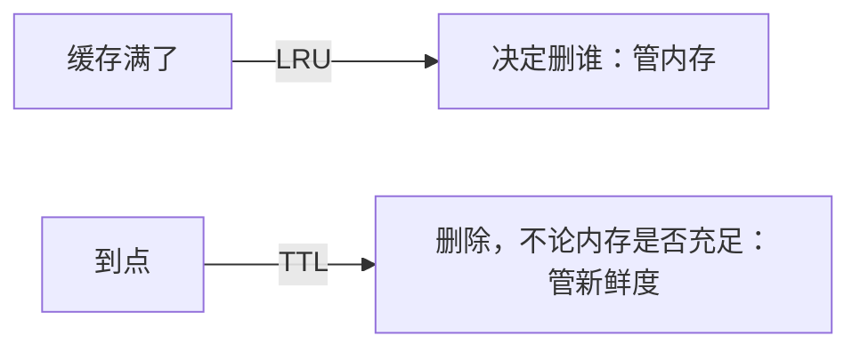

## Q
**缓存 · TTL 与 LRU 一起用**｜考点 · 追问
面试官问：既然有 LRU，为什么还要给用户资料设 10 分钟 TTL？两者解决的问题有什么不同？

## A
- **LRU 管内存：** 缓存满了才触发，决定删谁；一个很热的键可以几天不被淘汰，数据可能早就过期。
- **TTL 管新鲜度：** 不论内存是否充足，到点删除，保证数据最多陈旧一个 TTL；也是写入失效漏掉时的兜底。
- **一起用：** LRU 防内存无限增长，TTL 防陈旧无限延续。
- **选 TTL 的长度：** 由业务能容忍的陈旧时长决定，不是越长越好。

