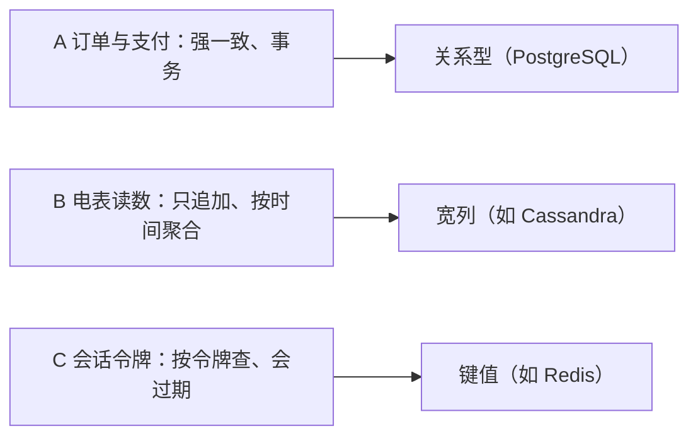

## Q
**数据建模 · 给场景选数据库**｜考点 · 必会
为三个系统选主存储并说理由：A) 网约车的订单与支付；B) 智能电表每秒上报读数，只追加并按时间聚合；C) 每个登录用户的会话令牌，按令牌查，几分钟过期。

## A
- **A 关系型（PostgreSQL）：** 订单与支付要强一致、事务，不能重复扣款或超卖，ACID 正对口，实体关系清晰。
- **B 宽列（如 Cassandra）：** 写入量巨大、只追加、按时间聚合。以 (meter_id, 时间) 为键，同一电表的数据连续存放，写是追加、读是范围扫描。
- **C 键值（如 Redis）：** 只按令牌这一个标识取，要极快，且可设过期时间自动清除。

- **常见错误：** 把 A 也塞进文档库或把 C 建成关系表。关键是"访问模式 + 一致性要求"而不是技术名气。
