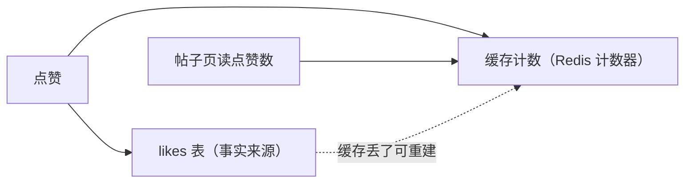

## Q
**数据建模 · 点赞数放哪里**｜考点 · 必会
帖子页要显示点赞数，每次 `COUNT(*)` 扫 likes 表太慢。你把 `like_count` 复制进 posts 表，会引入什么新问题？如何不损失可信度？

## A
- **新问题：** 每次点赞要同时写 likes 与 posts 两处，若只成功一处就产生漂移；热门帖子上，大量并发写同一行会形成行锁争用。
- **保证一致：** 同一事务里同时写入，或接受最终一致，用异步任务定期按 likes 重算校正。
- **更干净的做法：** likes 表仍是事实来源，计数放在缓存中（如 Redis 计数器），读走缓存，缓存丢了可从 likes 重建。

- **面试表达：** 说明你反范式的理由是 feed 要快、且点赞可最终一致，并指出怎样对账；这体现了把选择与一致性要求挂钩。
