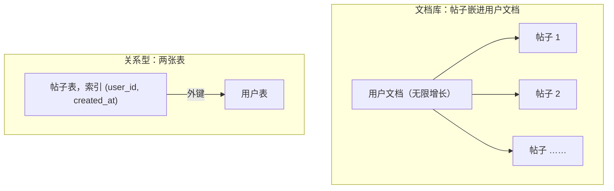

## Q
**数据建模 · 文档库选错了的信号**｜考点 · 必会
一位候选人为"论坛"选了 MongoDB，理由是"灵活"，并把全部帖子嵌进用户文档里。指出两个问题。

## A
- **理由站不住：** 面试题的需求是明确固定的，没有"模式不断演化"这个选文档库的主要理由。
- **嵌套的代价：** 帖子嵌进用户文档，用户文档会无限增长；修改一条帖子要重写整个用户文档；而且"按时间取全站最新帖子"这个查询要扫所有用户文档。
- **更好的选择：** 关系型，用户一张表、帖子一张表，外键 + `(user_id, created_at)` 索引。

- **补充：** 文档库真正适用的是不同记录结构差别很大、深度嵌套的数据。
