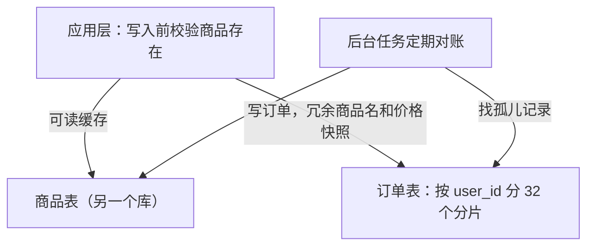

## Q
**数据建模 · 评审建议加外键，可行吗**｜考点 · 追问
订单表每秒写入约 8 万，已按 `user_id` 分成 32 个分片；订单行引用商品表，而商品表放在另一个库里。评审意见是"补上外键保证数据完整"。你怎么回应？

## A
- **技术上做不到：** 外键由单个数据库实例强制，商品表在另一个库，订单所在的分片也与它不在同一实例，数据库无法跨库校验。
- **即使同库也有代价：** 每次插入都要去校验被引用的行，写入这么高时成为开销，还会增加锁竞争。
- **替代办法：** 在应用层写入前校验商品存在（可读缓存），订单里冗余当时的商品名和价格作为快照（也符合"下单时价格"的业务语义）；后台任务定期对账找出孤儿记录。

- **表达：** 说明这是用校验成本换写吞吐的取舍，并且给出补偿的完整性手段，而不是简单地说"不要外键"。
