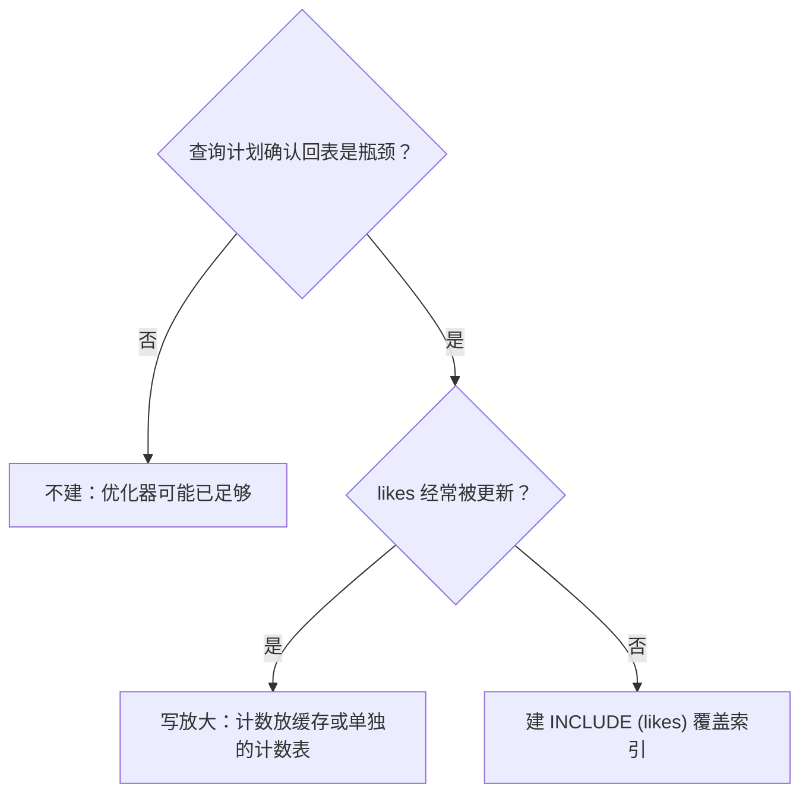

## Q
**数据库索引 · 要不要建覆盖索引**｜考点 · 追问
feed 页的查询只取 `user_id, created_at, likes`，表里还有大文本列。团队想用 `INCLUDE (likes)` 建覆盖索引。你同意吗？该看哪些条件？

## A
- **适合的条件：** 该查询高频、读密集；大文本列使回表代价高；索引多出的 `likes` 列很小；`likes` 更新不太频繁。
- **反对的理由：** `likes` 经常被更新时，每次更新都要改索引条目，写放大；索引变大占缓存；优化器可能已足够。
- **更稳妥：** 先测量，用查询计划确认回表确实是瓶颈；如果可以，把热点计数放缓存或单独的计数表。

- **回答风格：** 有理由才用，别把它当默认。
