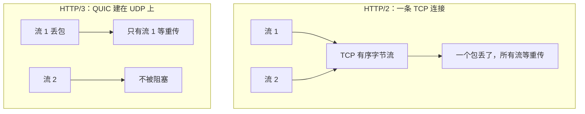

## Q
**网络基础 · 从 HTTP/1.1 到 HTTP/3：队头阻塞**｜拓展 · 加分

HTTP/2 已经多路复用了，为什么还要 HTTP/3 和 QUIC？

## A
- **HTTP/1.1：** 一条连接上请求要排队，浏览器只能开多条连接绕开，每条都付握手成本。
- **HTTP/2：** 一条 TCP 连接上多路复用多个流，解决了 HTTP 层的队头阻塞。但 TCP 只看到一条有序字节流，其中一个包丢了，所有流都要等重传，这是传输层的队头阻塞，丢包率高的网络（手机）上明显。
- **HTTP/3 / QUIC：** 建在 UDP 之上，由 QUIC 在用户空间自己实现可靠性、拥塞控制和加密，每个流独立，一个流丢包不阻塞其他流。握手把传输和 TLS 1.3 合在一次往返里，恢复连接时可以 0-RTT。连接用连接 ID 标识，手机切换网络（Wi-Fi 到蜂窝）不用重建。

- **代价：** 在用户空间实现更耗 CPU；一些网络会拦截或限速 UDP，所以客户端通常准备回退到 TCP。
- **2026 亮点：** HTTP/3 已经大规模部署，不只是加分概念：nginx 1.25 起支持，Cloudflare 2025 年约五分之一的请求已走 HTTP/3；首次访问先走 TCP，靠 Alt-Svc 响应头或 DNS 的 HTTPS 记录发现 h3，失败回退 HTTP/2。面向用户的 CDN/边缘值得开，机房内部低丢包链路用 HTTP/2 的 gRPC 即可。
- **面试说法：** 把 QUIC 当作"更现代的 TCP"，在延迟敏感、移动端占比高的场景作为加分点，而不是默认。
