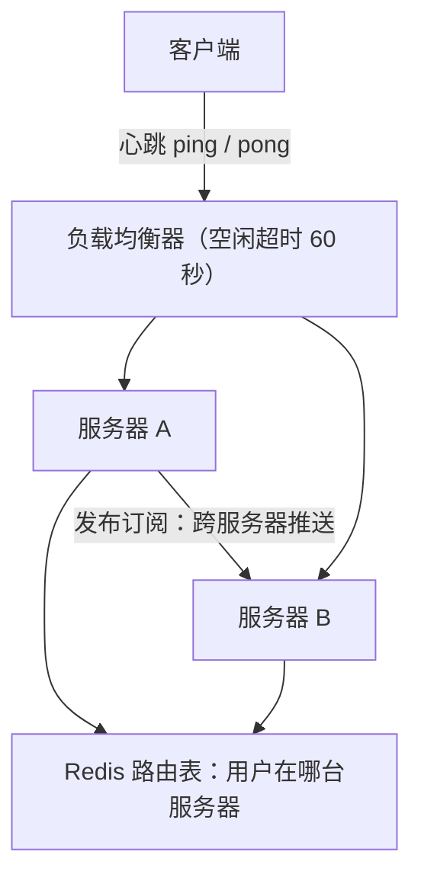

## Q
**网络基础 · 长连接在生产中的坑**｜拓展 · 加分

WebSocket 或 SSE 部署到生产后，除了选 L4，还要处理哪些现实问题？

## A
- **空闲超时：** 负载均衡器和代理会关闭长时间无数据的连接（例如 AWS ALB 的空闲超时默认 60 秒）。要定期发心跳（WebSocket 的 ping / pong，SSE 的注释行），并且让超时配置大于心跳间隔。
- **重连风暴：** 服务器重启或发布时，几十万连接同时断开又同时重连，瞬间打满认证和握手。客户端重连要指数退避加抖动，服务端发布要分批排空（draining）：先停止接受新连接、通知客户端迁移，再关闭旧连接。
- **连接数是资源：** 每个连接占文件描述符和内存；单台服务器能承载的连接数要压测。均衡器到后端的连接数受端口数量限制（一个源地址到同一个目标地址和端口，可用临时端口默认只有约 2.8 万个，调大范围后最多约 6 万），大规模时要多个源 IP 或多个后端地址。
- **状态：** 连接绑定在一台服务器上，要给"用户在哪台服务器"找个地方存（如 Redis 的路由表），跨服务器推送靠发布订阅。

- **所以：** 长连接系统的难点在运维：心跳、重连、排空、状态路由，而不在协议本身。
