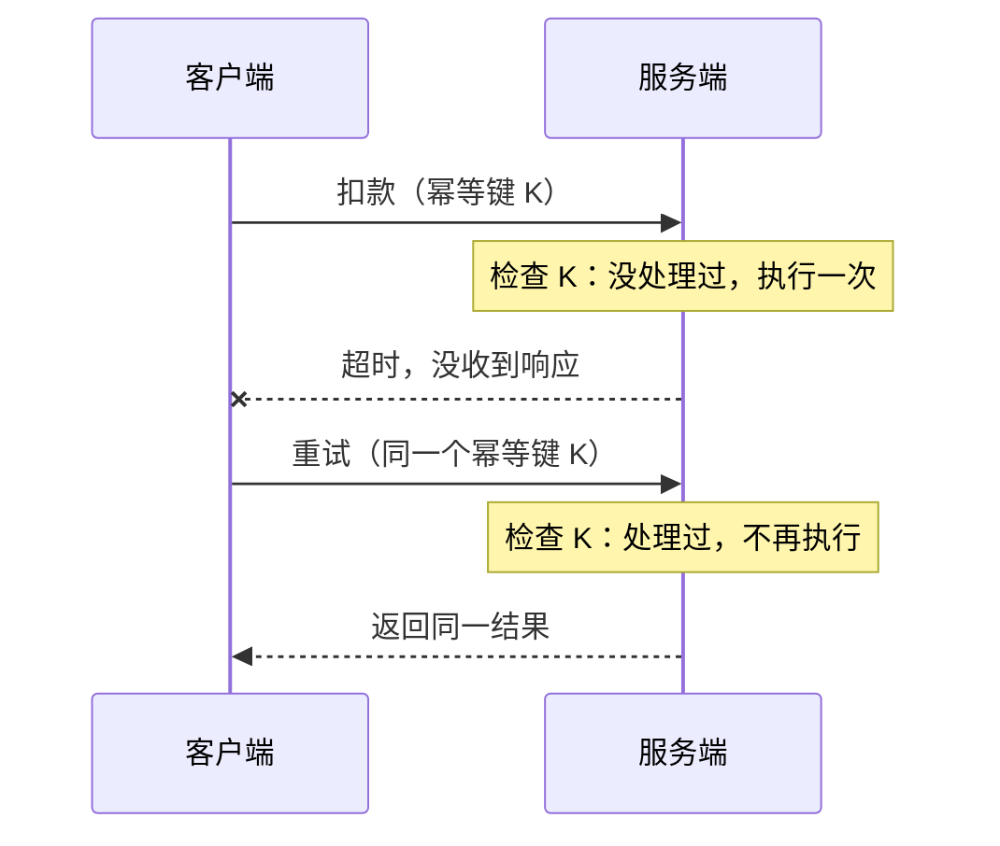

## Q
**网络基础 · 支付请求的重试**｜考点 · 必会

客户端调用扣款接口超时了，要不要重试？怎么保证不会扣两次？

## A
- **要重试，但要幂等：** 超时不代表没成功，直接重试可能重复扣款。
- **幂等键：** 请求带唯一键（如用户 ID 加订单 ID，或客户端生成的 UUID），服务端先检查是否处理过或正在处理，只执行一次，重复请求返回同一结果。

- **两种风格：** 友好的实现等请求完成后把结果返回给所有请求者；简单的直接返回"已存在"。
- **注意：** 键要用同一个请求重试时保持不变，不同的新请求用新键。
