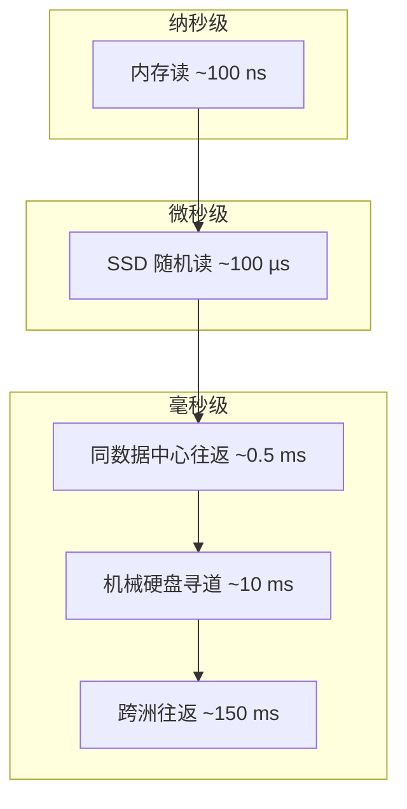

## Q
**必知数字 · 经典延迟量级表**｜拓展 · 加分
不查资料，内存、SSD、网络、磁盘寻址各是什么数量级？这张表怎么在面试里用？

## A
- **延迟数字看数量级：**
  - **内存读：** 约 100 纳秒。
  - **SSD 随机读：** 约 100 微秒（0.1 毫秒）量级。
  - **同数据中心内一次往返：** 约 0.5 毫秒。
  - **机械硬盘寻道：** 约 10 毫秒。
  - **跨洲网络往返：** 约 150 毫秒。
- **记忆方式：** 从内存（纳秒级）到 SSD（微秒级）再到磁盘与网络（毫秒级），每跨一档大约慢 10 到 1000 倍，所以"内存里的多次读取"远快于"一次网络往返"，一次跨洋往返可抵得上上百万次内存读取。

- **用法：** 估算请求延迟时数一数有几次网络往返、几次磁盘读取，把它们加起来，比抠 CPU 指令有意义得多。顺序读比随机读快得多，所以日志式、追加式存储友好。
- **注意：** 具体数值随硬件变化，答数量级和比例而不是死背小数点。
