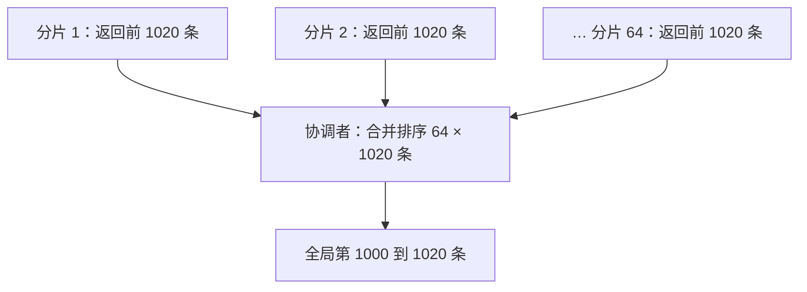

## Q
**分片 · 跨分片分页与 Top-K 的正确做法**｜拓展 · 加分
想从 64 个分片里取全局排序后的第 1000 到 1020 条，为什么极其昂贵？合并 top-K 时有什么实用技巧？

## A
- **深分页的放大：** 要得到全局第 1000-1020 条，每个分片都得返回自己的前 1020 条，协调者再合并排序，总共搬 64 × 1020 条只为取 20 条；偏移越深越贵。
- **所以：** 避免跨分片的深分页；改用游标（以上一页最后一条的排序键为起点，每个分片只返回比它大的前 20 条），每次每片取 20 条，用堆合并。
- **Top-K 合并的正确性：** 全局前 K 必然包含在各分片的局部前 K 里，所以各取 K 个再合并是精确的；Python 可用 `heapq.nlargest(k, chain(...))` 或 `heapq.merge`（要求各输入已有序）。
- **二级索引的难点：** 按非分片键查询（如按邮箱找用户）需要扇出到所有分片，或维护一个全局二级索引（自身也要分片，且更新要跨分片，通常最终一致）。

