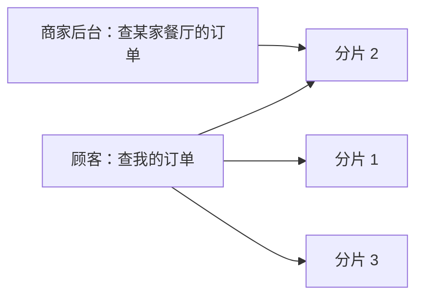

## Q
**分片 · 评价分片键**｜考点 · 必会
评价三个分片键：A) 外卖平台的订单表按 `restaurant_id` 分；B) 日志表按 `log_date` 分；C) 用户表按 `country` 分。分别指出问题或优点。

## A
- **A 有隐患：** 基数大、均匀性取决于餐厅规模；连锁大店和热门餐厅的订单量很不均衡，可能出热点；但"查某家餐厅的订单"落在单分片，对商家后台友好。而顾客查"我的订单"需要查所有分片，要用二级索引或再冗余一份按 `user_id` 分的数据。
- **B 差：** 所有新日志都写入当天的分片，写热点；老分片几乎闲置。仅当用于归档或分析（写分散、按时间范围读）才合适。
- **C 差：** 基数低（最多一两百个国家），分布极不均（少数国家占大头），无法扩到更多分片。
- **答题方式：** 按基数、均匀性、与查询对齐三条逐一过。

A 按 `restaurant_id` 分时两种查询的落点：

