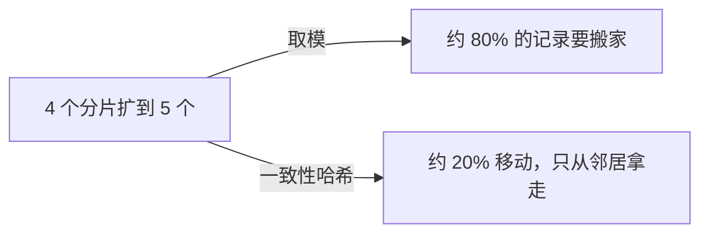

## Q
**分片 · 取模分片扩容**｜考点 · 必会
4 个哈希分片（`hash(id) % 4`）要扩到 5 个。大约有多少比例的记录要换分片？一致性哈希下呢？

## A
- **取模：** 一条记录留在原分片，需要 `h % 4 == h % 5`。在 20 个连续取值（lcm 为 20）里只有 h = 0,1,2,3 满足，也就是 4/20 = 20%，所以约 80% 的记录要搬家。
- **一致性哈希：** 新节点只接管环上一部分区间，理论上约 1/5 = 20% 的数据移动（只从邻居拿走，其余不动）。
- **含义：** 取模下扩容是一次大规模数据搬迁，伴随大量缓存失效和流量冲击；所以用哈希分片必须有一致性哈希或预先切好许多逻辑分片的计划。

