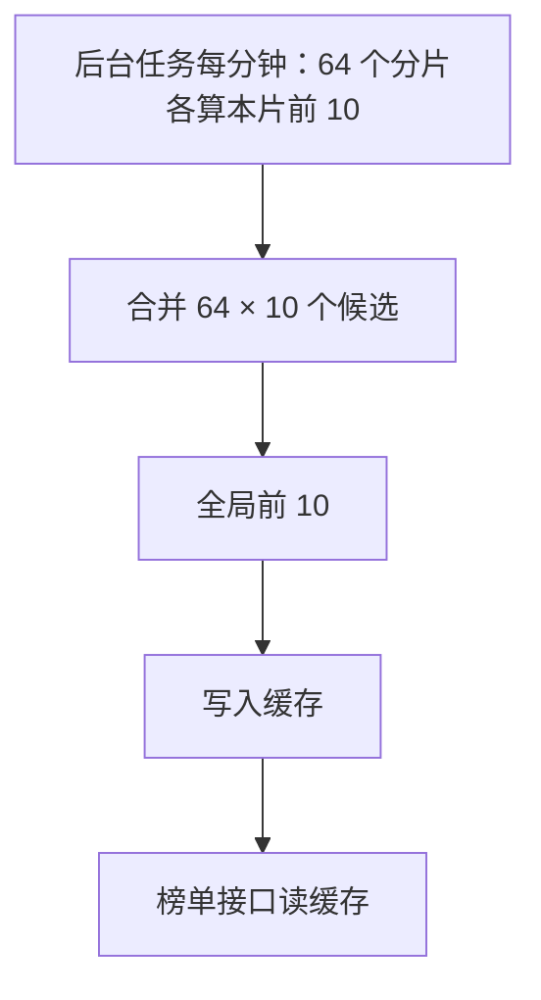

## Q
**分片 · 全站榜单怎么做**｜考点 · 必会
评论、点赞等数据按 `post_id` 分在 64 个分片，要做"过去一小时点赞最多的 10 个帖子"榜单功能，每秒上千次访问。你的方案是什么？

## A
- **别每次扇出：** 每次请求查 64 个分片，延迟被最慢的分片决定，网络调用 64 倍。
- **方案：** 后台任务每分钟按分片各自算出本片的前 10（局部 top-K），汇总（合并 64 × 10 个候选）后得到全局前 10，写入缓存，榜单接口读缓存。
- **正确性：** 全局前 K 一定出现在某个分片的局部前 K 里，所以局部各取 K 个再合并是精确的（前提是帖子只在一个分片上，点赞数不跨分片拆分）。
- **取舍：** 榜单延迟约一分钟，能接受最终一致；如要实时，用流处理（按帖子计数）更新计数器。

