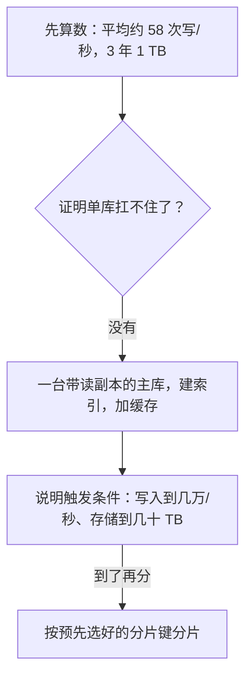

## Q
**分片 · 过早分片的判断**｜考点 · 必会
面试官给出：日活 100 万，每人每天写 5 次，数据总量预计 3 年 1 TB。候选人立刻说"用 user_id 分 32 个分片"。你怎么评价，应该怎样回答？

## A
- **计算：** 写入 500 万/天，平均约 58 次/秒（5,000,000 ÷ 86,400），即使峰值取 10 倍也只有几百次/秒；1 TB 一台机器放得下。
- **评价：** 在没有证明单库扛不住之前引入分片，是最常见的错误：它带来跨分片查询、一致性和运维复杂度，却没有对应的收益。
- **应该这样答：** 先用一台带读副本的主库，给查询建索引，加缓存；说明触发分片的条件（例如写入到几万/秒、存储到几十 TB），并预先选好分片键。
- **2026 亮点：** 大规模 Postgres 的实践是先榨干单主：读副本、连接池、分级限流、缓存把主库压力降下来，只把写密集且有天然分片键的数据迁出到分片系统，而不是整库分片，保留关系型事务和 join 的简单。代价是主库仍是单点写，要提前约束 schema 变更和长查询。
- **表达：** 先算数，再给结论。

