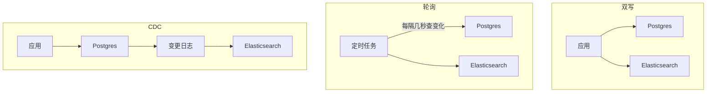

## Q
**变更数据捕获 · CDC 要解决什么问题**｜摘要 · 必会

要让搜索索引（如 Elasticsearch）和主数据库（如 Postgres）保持同步，双写、轮询、CDC 各是什么做法，各有什么毛病？

## A
- **场景：** 商品目录在 Postgres（真相来源），搜索走 Elasticsearch，商品每次新增、修改、删除都要同步过去。
- **双写（dual write）：** 应用同时写两个系统。一个成功一个失败，两边就不一致；要补重试、幂等，还要处理应用在两次写之间崩溃的情况。
- **轮询：** 定时任务每隔几秒查数据库找出变化再同步。反复查询给数据库加压，还得自己维护「上次轮询以来哪些记录变了」的逻辑。
- **CDC（Change Data Capture）：** 直接从数据库内部的变更日志里读出变化，实时传给下游。应用只写一个库，不用管同步。
- **提示：** CDC 常常正好合适，但也常被用在不合适的地方，关键是判断场景。

