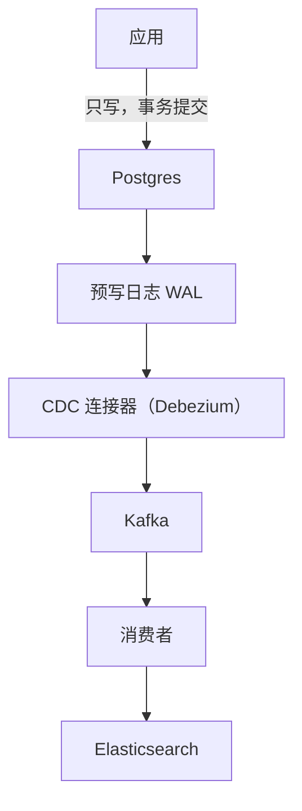

## Q
**变更数据捕获 · CDC 的工作原理**｜摘要 · 必会

CDC 具体读的是什么？一条变化从数据库到 Elasticsearch，中间经过哪些组件？

## A
- **读什么：** 数据库为了崩溃恢复和副本同步，本来就会把每次变更先写进一份有序日志：PostgreSQL 叫预写日志（WAL，Write-Ahead Log），MySQL 叫二进制日志（binlog）。CDC 直接读这份现成的日志，不需要应用再多写一次。
- **提交后才可见：** 应用只写 Postgres，事务提交后，这些变更才通过 CDC 暴露给下游。
- **典型链路：** 数据库日志 → CDC 连接器（如 Debezium，提供 PostgreSQL、MySQL 等连接器）→ Kafka（传输层）→ 消费者写进 Elasticsearch。
- **解耦：** 消费者不参与原始写入，应用不知道它们存在，新增消费者不用改应用代码。

