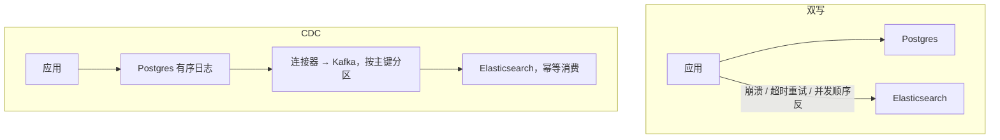

## Q
**变更数据捕获 · 双写的崩溃窗口**｜考点 · 必会

应用先写 Postgres 再写 Elasticsearch。列出会导致不一致的所有失败点，并说明 CDC 怎样消除它们。

## A
- **失败点：** 写 Postgres 成功后应用崩溃，搜索没更新；写 Postgres 成功但写 ES 失败或超时，重试又可能写入两次；两个并发请求对同一商品，两个系统里的写入顺序相反，最终值不同。
- **补救的成本：** 重试、幂等、崩溃恢复都要应用自己写。
- **CDC 的做法：** 应用只写数据库，事务提交与否决定了变更是否在日志中。日志有序，连接器按序读，在 Kafka 里按主键分区，同一个商品的更新有序，最终两边一致。
- **保留的问题：** 仍有滞后；消费者要幂等，因为投递是至少一次。
- **要点：** CDC 把「两个系统写什么」变成「一个有序日志，下游自己追」。

