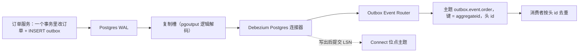

## Q
**变更数据捕获 · 用 Debezium 把发件箱表发到 Kafka：一行怎么变成一条消息**｜拓展 · 必会

订单服务在一个事务里改订单、插一行 outbox。用 CDC（变更数据捕获）做中继时，这一行经过哪些组件、怎样变成 Kafka 里的一条消息？主题、键、去重 ID 分别从哪来？连接器重启会怎样？

## A
**一句话。** 应用只管在业务事务里 `INSERT` 发件箱行；Postgres 把它写进 WAL（预写日志），Debezium 通过复制槽（replication slot）用逻辑解码读到这次插入，Outbox 事件路由转换（Outbox Event Router）按 `aggregatetype` 选主题、以 `aggregateid` 作消息键、把行 `id` 放进消息头，Kafka Connect 写出后再记下读到的 WAL 位置（LSN）。

**步骤。**
1. **建表：** 默认列是 `id`（UUID）、`aggregatetype`、`aggregateid`、`type`、`payload`（jsonb）。
2. **写入：** 业务事务里改订单并插入 `(id=e1, aggregatetype='order', aggregateid='o42', type='OrderPaid', payload=…)`，一起 `COMMIT`。回滚的事务不会出现在逻辑解码的输出里，所以不会发出"从未发生"的事件。
3. **读日志：** 连接器通过复制槽按提交顺序读 WAL，只看到已提交的变更，不对表发任何查询。
4. **路由：** Outbox Event Router 把这条插入改写成一条干净的业务消息：主题默认 `outbox.event.${routedByValue}`，取 `aggregatetype` 的值，这里是 `outbox.event.order`；消息键是 `aggregateid`，同一订单进同一分区、保持顺序；值是 `payload`；行的 `id` 写进消息头 `id`。
5. **删除不发：** 路由器自动过滤发件箱表上的 `DELETE`，所以可以定期清理，甚至在同一事务里插入后立刻删除，表不会膨胀，日志里的插入照样被读到。
6. **记位置：** Kafka Connect 把已写出的 LSN 存进自己的位点主题，并向 Postgres 确认，复制槽才能回收这之前的 WAL。

**故障与处理。**
- **连接器在写出之后、提交 LSN 之前崩溃：** 重启后从旧 LSN 重读，同一事件再发一次。消费者按消息头 `id` 去重，所以是至少一次加无害重复。
- **连接器长时间停摆：** 复制槽不前进，WAL 无法回收，主库磁盘会被撑满；要监控槽的滞后字节数，并用 `max_slot_wal_keep_size` 设上限。
- **发件箱行被 UPDATE：** 路由器默认只记警告（`table.op.invalid.behavior=warn`），可配成 `error` 或 `fatal` 让连接器停下。发件箱应只插入，像一个队列。

**为什么这样，不那样。**
- **对比轮询中继：** 不给业务库加查询，延迟取决于读日志而不是轮询间隔；代价是多一套 Kafka Connect 和 Debezium 要运维，并且依赖数据库的复制槽。
- **对比直接 CDC 业务表：** 业务表的行变化是内部结构，换个列名就破坏下游；发件箱是应用写明的事件契约，带稳定的事件 ID 和类型。
