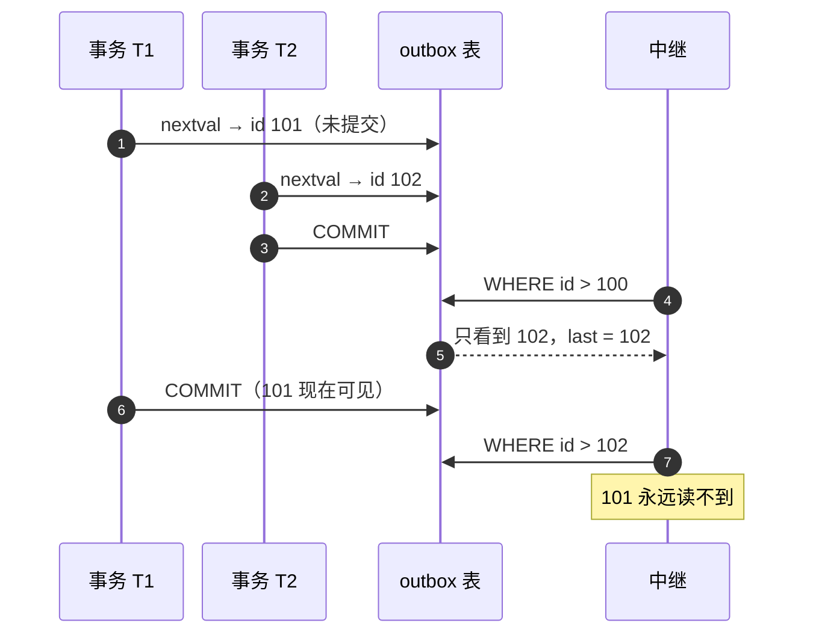

## Q
**变更数据捕获 · 轮询中继的三个坑：迟到提交、锁着发、多实例乱序**｜拓展 · 追问

不上 Debezium，用一个轮询中继读发件箱：`SELECT … FROM outbox WHERE id > :last ORDER BY id LIMIT 500`，多实例时加 `FOR UPDATE SKIP LOCKED`。这样写会漏事件吗？会乱序吗？锁要拿多久？

## A
**一句话。** 用 `id > 上次最大 id` 当游标会漏事件，因为序列号按分配顺序给、事务按另一个顺序提交；多实例加 `SKIP LOCKED` 能避免重复领取，却会打乱同一实体的顺序；在持锁的事务里发消息，锁要拿整个发送时长。用"未发送"标记代替游标，按实体把行固定分给一个中继，并且先领取、后发送、再标记。

**坑一：迟到提交。**
- **原因：** 序列值在 `nextval` 时分配、永不回滚；T1 先拿号后提交，T2 后拿号先提交。中继在两者之间读一次，游标就越过了还不可见的 101。
- **做法：** 不用游标，用状态列：`WHERE sent = false ORDER BY id`，配 `(sent, id)` 的部分索引；或者只读"足够旧"的行（`created_at < now() − 若干秒`），用一点延迟换安全。

**坑二：持锁发送。**
- **原因：** `SELECT … FOR UPDATE SKIP LOCKED` 在事务里锁住这批行，如果在同一个事务里逐条发 Kafka，锁要等全部发完才释放；中间卡住，别的实例只能跳过这些行，整批延迟。
- **做法：** 批要小（几百行）；或者两段式：短事务里把行标成 `claimed_by = me, claimed_until = now()+30s`，提交释放锁，再在事务外发送，发完 `UPDATE sent = true`。中继崩溃，`claimed_until` 过期后别人重领。

**坑三：多实例乱序。**
- **原因：** `SKIP LOCKED` 让实例 A 拿到订单 o42 的第 1 条、实例 B 拿到第 2 条，B 先发完，下游先看到第 2 条。
- **做法：** 按实体把行固定分给一个中继，如 `WHERE hash(aggregate_id) % 4 = :my_bucket`，桶的归属由租约或配置决定；或者下游按每个实体的版本号丢弃旧事件。

**数字与运维。**
- **监控：** 未发送行数，最老未发送行的年龄；后者是中继延迟最直接的告警。
- **清理：** 已发送行保留几天便于排查，按时间分区整块删除，比大批 `DELETE` 便宜。

**怎么选。** 量小、能接受秒级延迟，用轮询，少一套组件；要低延迟、不想给主库加查询、团队已经在运维 Kafka Connect，用 CDC。两者都是至少一次，消费者都要按事件 ID 去重。
