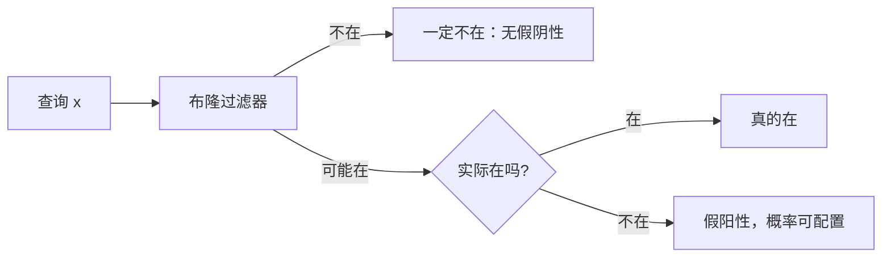

## Q
**大数据结构 · 布隆过滤器是什么**｜摘要 · 必会

布隆过滤器（Bloom filter）和哈希集合相比放宽了什么保证，换来了什么？

## A
- **哈希集合：** 插入和查询都是 O(1)，但每个元素都要占内存。万亿个 ID 根本装不下。
- **布隆过滤器：** 做一个折中，内存比哈希表小得多，但只能给出两种答案：「一定不在集合里」；「可能在集合里」，误判概率可配置。
- **方向很重要：** 假阴性不存在（它说不在就一定不在），只会有假阳性（说在但其实不在）。
- **不是什么：** 不存元素本身，所以不能列出里面有什么，也不能证明某个元素确实在里面。

