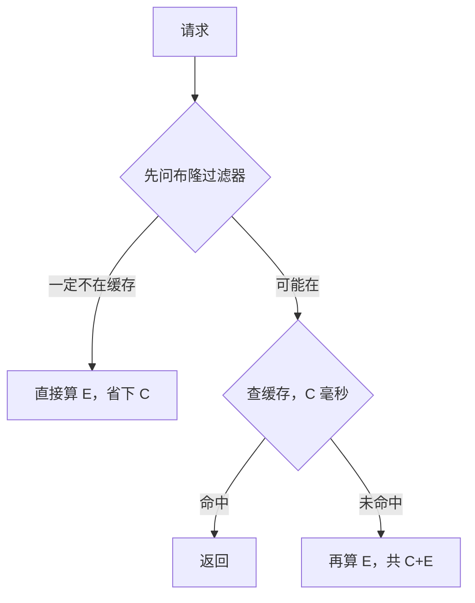

## Q
**大数据结构 · 布隆过滤器适用场景与坑**｜摘要 · 必会

什么情况下该用布隆过滤器？爬虫和缓存前置过滤各怎么用，各有什么坑？

## A
- **三个条件同时成立：** 要查成员关系；内存确实紧张（否则用哈希表）；能容忍假阳性。第二、三条在现实里不容易满足。
- **标准版不能删除：** 印章不能擦掉，所以不适合元素常更新或删除的集合。
- **网页爬虫：** 访问过的 URL 太大，哈希表存不下；漏爬几个网页可以接受，即容忍假阳性。用一个集中的布隆过滤器说「大概率见过这个 URL」，不存完整 URL。
- **缓存前置：** 缓存命中很快，但未命中要先白付一次缓存查询（C 毫秒）才去做昂贵的计算 E，总共 C+E。先问过滤器，一定不在缓存的直接算，省下 C。
- **缓存场景两个坑：** 缓存有 TTL 会淘汰，但过滤器不能删除，越用越不准；缓存常有多个写入者，别人已经写进缓存的结果，会被过滤器说成「不在」而错过命中。

