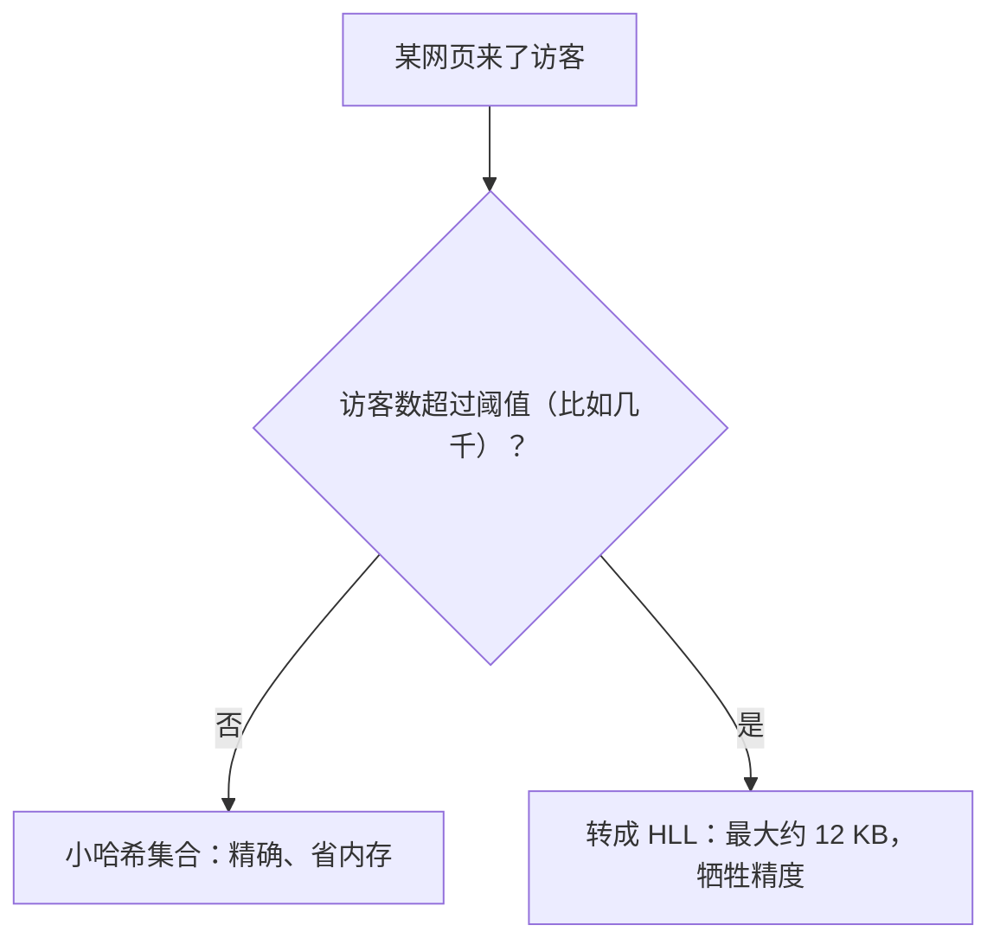

## Q
**大数据结构 · HyperLogLog 还是哈希集合**｜考点 · 必会

统计 1000 万个网页各自的独立访客数。绝大多数网页只有几十个访客，少数热门页有上亿。该怎么选结构？

## A
- **全用哈希集合：** 热门页内存爆炸；全用 HLL：1000 万个网页每个固定占 KB 级寄存器（Redis 的 HLL 最大约 12 KB），而冷门页的几十个访客用集合只要几百字节，白白浪费。
- **混合方案：** 先用小的哈希集合记录，超过某个阈值（比如几千）再转成 HLL。Redis 的 HLL 实现也有类似的稀疏表示到稠密表示的转换。
- **取舍：** 小基数时要精确且省内存，大基数时才牺牲精度。
- **加分：** 如果还需要「昨天与今天都来过」的人数（交集），HLL 不擅长，需要换思路或用别的结构。
- **面试说法：** 先用 HashSet，说明什么规模才需要 HLL，不要一上来就上概率型结构。

