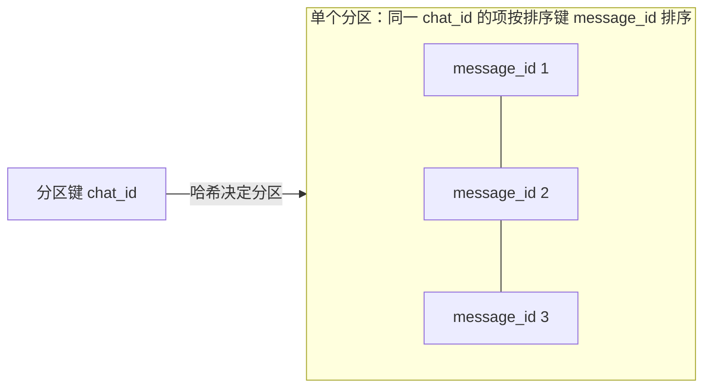

## Q
**DynamoDB · 分区键和排序键**｜摘要 · 必会

DynamoDB 的主键由什么构成？聊天应用里该怎么选，消息 ID 为什么不用时间戳？

## A
- **分区键（partition key）：** 必选，一个属性，对它做哈希决定数据放在哪个分区。
- **排序键（sort key）：** 可选；与分区键组成复合主键，同一分区键下的项按它排序，支持高效范围查询。
- **选键原则：** 分区键要贴合最常见的查询，并让数据均匀分布；需要范围查询或排序就加排序键。
- **聊天例子：** 分区键 `chat_id`、排序键 `message_id`，取出某个群的消息就是在单个分区内顺序读取。
- **不用时间戳：** 同一毫秒内可能有多条消息，时间戳不保证唯一；单调递增的 ID 同时给出顺序和唯一性。生成方式有每分区自增计数器、UUID v7（时间在前，可按字符串排序，不泄露机器的 MAC 地址）、Snowflake ID、ULID。

