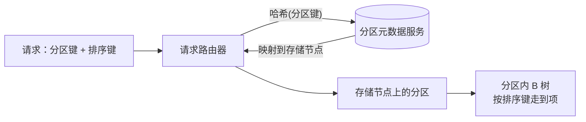

## Q
**DynamoDB · 键背后：哈希分区加 B 树**｜摘要 · 追问

DynamoDB 怎么定位一个项？它和原版 Dynamo 论文的哈希环有什么不同？

## A
- **两层结构：** 先对分区键哈希，找到分区；分区内的项用 B 树按排序键组织，所以范围查询和排序高效。
- **定位过程：** 请求路由器查询分区元数据服务，把哈希值映射到存储节点；复合主键则先找节点，再用排序键在 B 树里走到对应项。
- **和 2007 年 Dynamo 论文的区别：** 论文里是点对点的一致性哈希环；DynamoDB 用集中的分区映射和放置服务，分区随着数据增长由该服务自动拆分与合并。

- **得到的效果：** 分区带来水平扩展，分区内 B 树带来快速而可预测的查询。
