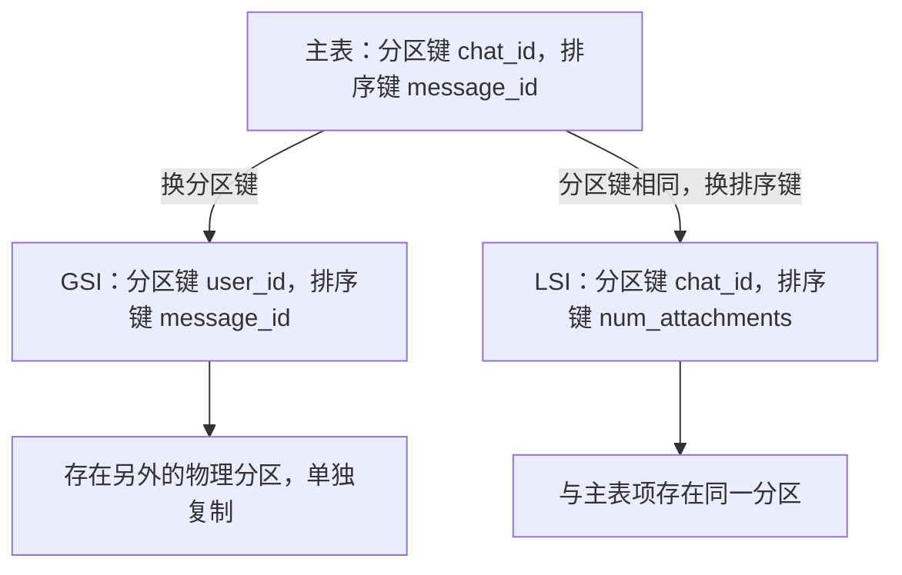

## Q
**DynamoDB · 二级索引：GSI 与 LSI 解决什么问题**｜摘要 · 必会

要按非主键属性查询怎么办？全局二级索引（GSI）和本地二级索引（LSI）怎么区分？

## A
- **GSI：** 分区键（及可选排序键）与主表不同的索引。数据存放在另外的物理分区，单独复制，所以能按任何属性高效查询。例：聊天表以 `chat_id` 分区，要查"某用户发过的所有消息"，建一个以 `user_id` 为分区键、`message_id` 为排序键的 GSI。
- **LSI：** 与主表同一个分区键，但排序键不同。数据与主表项存放在同一分区，用于在一个分区内按另一个属性排序或做范围查询。例：在群内找附件数最多的消息，建以 `num_attachments` 为排序键的 LSI。
- **取舍：** GSI 灵活但多占存储和写入开销；LSI 在分区内更高效但灵活性受限。
- **设置：** 都是在控制台或 SDK 里声明，系统自动维护。

