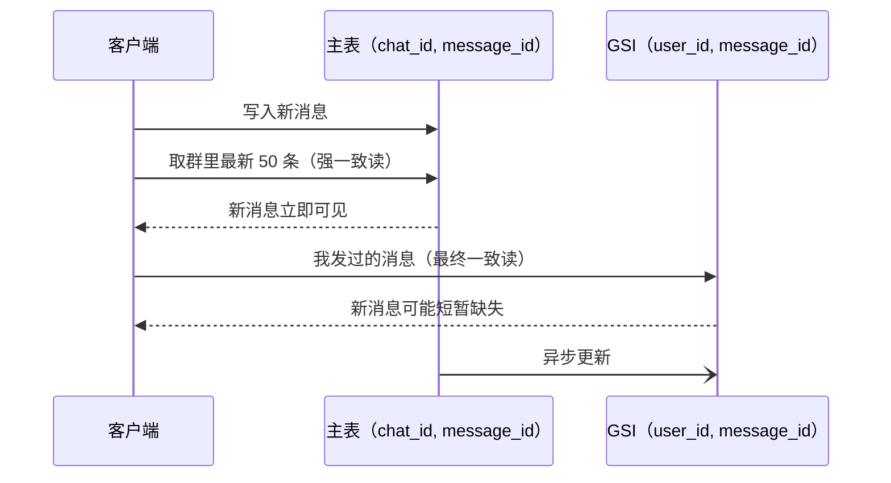

## Q
**DynamoDB · 聊天应用的键和索引**｜考点 · 必会

聊天应用要支持：取某个群最近的 50 条消息；列出某用户在所有群发过的消息；刚发的消息要立刻在群里出现。给出表、键和索引，并指出刚发的消息在哪个查询里可能暂时看不到。

## A
- **主表：** 分区键 `chat_id`，排序键 `message_id`（单调递增 ID），倒序查询取最新 50 条。
- **GSI：** 分区键 `user_id`，排序键 `message_id`，用于"某用户发过的消息"。
- **刚发的消息：** 群里查询走主表，可以请求强一致读，立即可见；走 GSI 的"我发过的消息"是异步更新的最终一致读，可能短暂缺失，需要时在客户端把刚发的消息合并显示。
- **GSI 不能强一致：** 如果必须强一致地按用户查询，只能把数据按另一种键再写一张表（同事务写入），而不是靠索引。
- **注意：** 热门大群的 `chat_id` 单分区写入也受限，见热点分区的考题。

