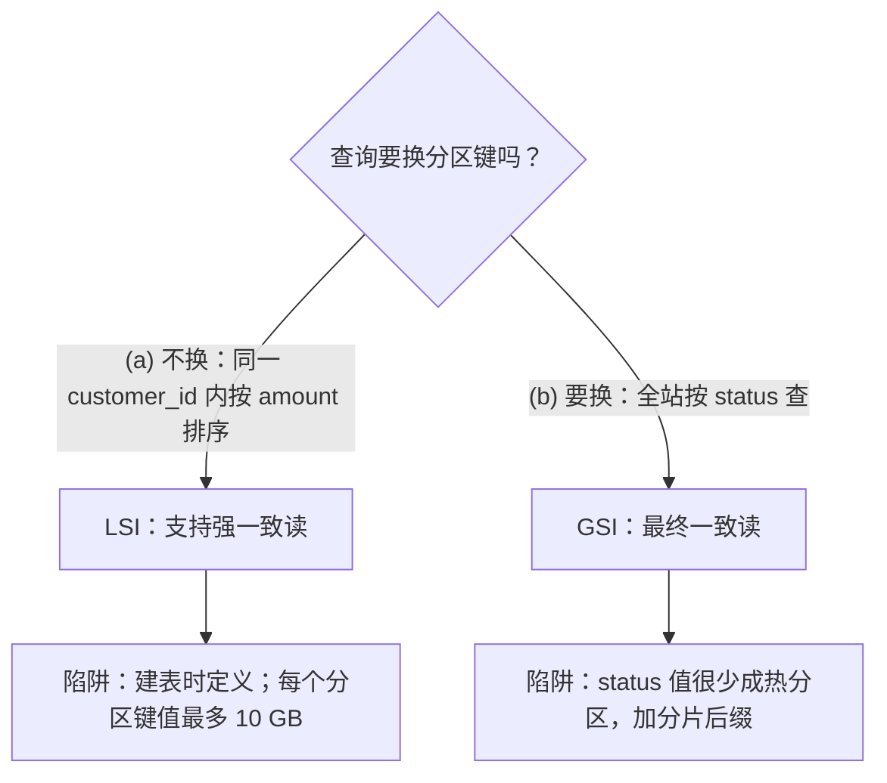

## Q
**DynamoDB · 该建 LSI 还是 GSI**｜考点 · 必会

订单表分区键是 `customer_id`，排序键是 `order_id`。需求：(a) 某客户的订单按金额排序，且要强一致读；(b) 按订单状态在全站查找待处理订单。各自该怎么选？有什么陷阱？

## A
- **(a) LSI：** 分区键相同，只换排序键为 `amount`；LSI 支持强一致读，且随主表同步更新。
- **LSI 的陷阱：** 必须在建表时定义，之后加不了；每个分区键值下数据最多 10 GB，大客户的订单可能超限；与主表共用吞吐。
- **(b) GSI：** 要跨所有客户按 `status` 查，必须换分区键，所以只能是 GSI（分区键为 `status`）。
- **GSI 的陷阱：** `status` 值很少，所有"待处理"订单落在同一分区键下，形成热分区；可以加分片后缀（如 `PENDING#3`）分散，读取时查所有后缀再合并。
- **一致性：** GSI 读是最终一致，刚下的订单可能暂时没出现在待处理列表里。

