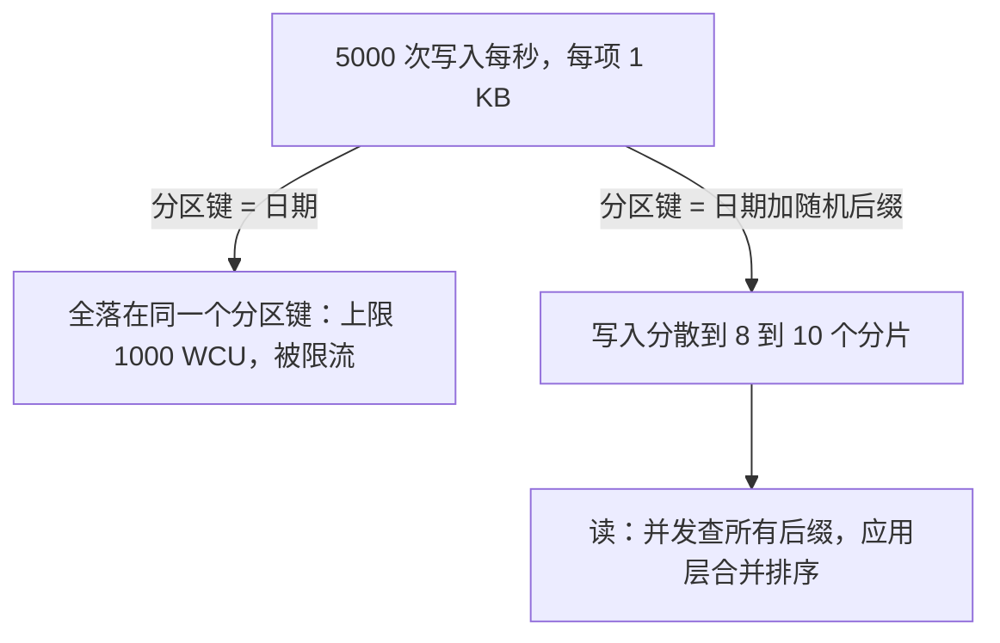

## Q
**DynamoDB · 热分区与写入分片**｜考点 · 必会

日志表的分区键是日期，排序键是时间戳。每天高峰有 5000 次写入每秒，每项 1 KB。会发生什么？怎么改？

## A
- **问题：** 同一天的所有写入落在同一个分区键。单分区写上限是 1000 个 WCU，5000 次写入每秒需要 5000 个 WCU，会被限流。
- **根因：** 分区键基数太低、写入集中在"当前"这一个值上。
- **改法：** 写入分片：分区键加上随机后缀 `date#0..N`，N 至少 5 个分片，实际取 8 到 10 个留余量；写入时随机选后缀。
- **读的代价：** 查一天的日志要并发查询所有后缀，再在应用层合并排序，读变复杂。
- **更好的方向：** 如果主要是按时间范围分析，考虑把日志写进专门为此设计的存储，不一定要用 DynamoDB 承载。

