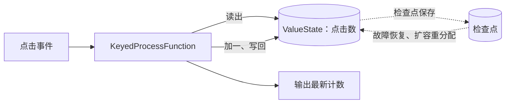

## Q
**Flink · 状态：让 Flink 知道你的状态**｜摘要 · 必会

算子的状态是什么？为什么必须交给 Flink 管理而不是自己放在内存里？

## A
- **有状态算子：** 算子可以在多个事件之间保存信息，比如统计一个用户 5 分钟内的点击要记住点击数和时间。
- **状态类型：** 值状态（每个键一个值）、列表状态、映射状态、聚合状态、归约状态。
- **例子：** 继承 `KeyedProcessFunction`，声明一个 `ValueState<Long>` 存点击数，每来一条事件读出、加一、写回并输出。
- **为什么必须声明给框架：** 只有 Flink 知道的状态才会被检查点保存、故障时恢复，并在扩容时重新分配；自己放在普通变量里的计数，一崩溃就丢了。

- **效果：** 为每个用户维护持续更新的计数，每来一次点击就输出最新值。
