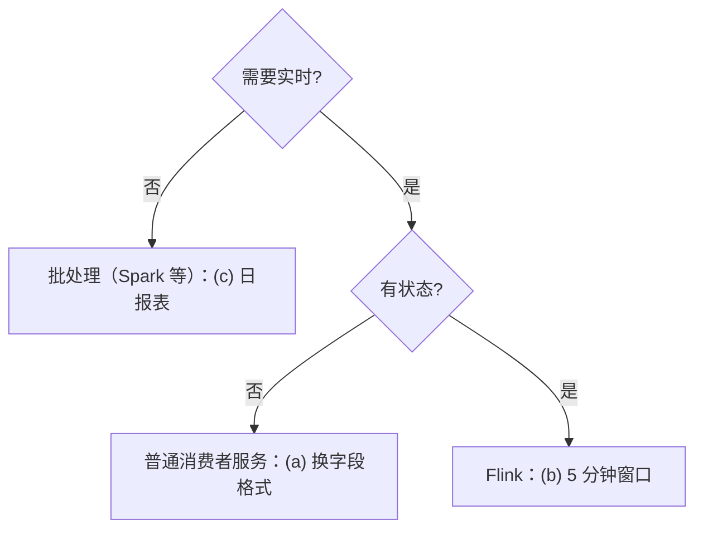

## Q
**Flink · 该不该上 Flink**｜考点 · 必会

三个需求：(a) 读 Kafka 的点击事件，换一下字段格式后写入数据库；(b) 每个用户最近 5 分钟的点击数，实时更新给风控；(c) 每天凌晨出前一天的广告报表。各用什么？

## A
- **(a) 普通消费者服务：** 无状态、逐条处理，起一个消费 Kafka 的服务即可，用 Flink 是杀鸡用牛刀，还增加运维。
- **(b) Flink：** 有 5 分钟窗口，意味着要保存状态、处理乱序和迟到、在崩溃与扩容时保证状态可恢复，这些正是 Flink 的强项。
- **(c) 批处理（Spark 等）：** 延迟要求是天级，没有实时需求，批处理更简单，也更便宜。
- **判断顺序：** 先问是否需要实时；再问有没有状态；有状态且要实时才上 Flink。

