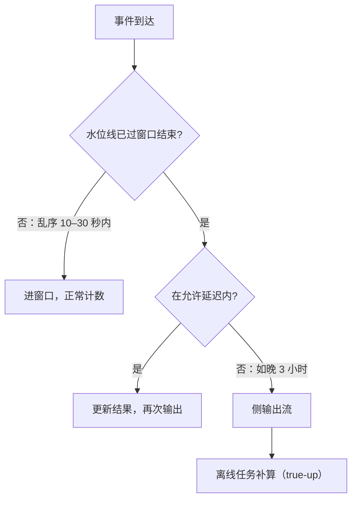

## Q
**Flink · 水位线延迟怎么定**｜考点 · 必会

一个按事件时间统计 5 分钟订单量的作业，大多数事件延迟不到 10 秒，但偶尔有手机离线后上传的事件晚 3 小时到达。你怎么配置水位线？极晚数据怎么办？

## A
- **有界乱序设为 10 到 30 秒：** 窗口在结束后再等这段时间才触发，结果延迟约等于这个值。设 3 小时的话每个窗口都要多等 3 小时才输出，实时性没了。
- **折中的原因：** 水位线等得越久越准，但延迟越大、状态占用越久；等得短则快，但会丢更多迟到事件。
- **允许延迟（allowed lateness）：** 窗口触发后再保留一小段时间，晚到的事件会更新结果并再次输出。
- **极晚数据：** 不要为它拖累主链路，把它输出到侧输出流，或者留给离线任务定期补算（true-up）修正数据。
- **要点：** 对准确性要求高的系统，实时结果加离线补算是常见组合。

