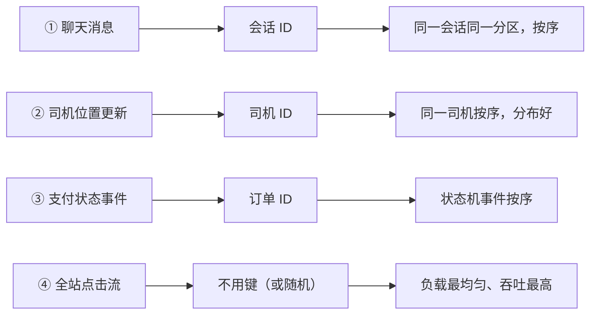

## Q
**Kafka · 为四种数据选分区键**｜考点 · 必会

为下列主题选分区键并说明理由与风险：①聊天消息（要求同一会话内按序）②网约车司机位置更新③支付状态事件（同一订单的状态要按序）④全站点击流（只做按小时汇总，顺序无所谓）。

## A
- **① 会话 ID：** 同一会话落同一分区，按序。风险：超大群聊成为热点，可对超大会话再加子分片或限速。
- **② 司机 ID：** 同一司机的位置按序，利于只保留最新位置；司机数量大且各自流量均匀，分布好。
- **③ 订单 ID：** 保证状态机事件顺序（创建→支付→完成）；订单天然均匀。
- **④ 不用键（或随机）：** 顺序无关，粘性分区器让负载最均匀、吞吐最高；消费者按小时汇总时各自局部聚合再合并。

- **通用原则：** 键要有高基数、分布均匀，并包含所有"必须有序的东西"；有序范围越大，并行度越低。
