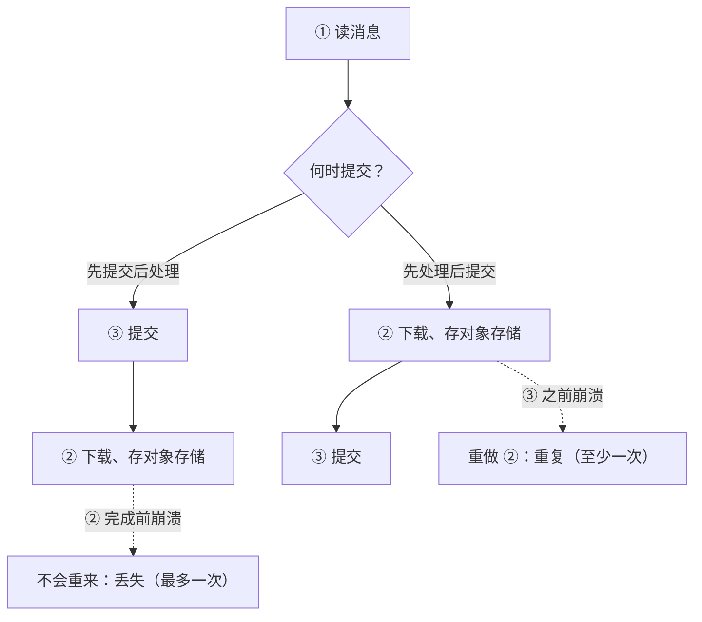

## Q
**Kafka · 提交偏移量的时机**｜考点 · 必会

消费者流程：①读消息 ②下载网页内容并存进对象存储 ③提交偏移量。分别分析：在 ② 之前提交、在 ② 之后提交，崩溃时各会怎样？怎么让重复处理无害？

## A
- **先提交后处理：** ① 之后立刻提交，再做 ②。在 ② 完成前崩溃，消息已被标记处理完，再也不会重来，造成丢失（最多一次）。
- **先处理后提交：** ② 做完再提交。在 ② 之后、③ 之前崩溃，重启后重做 ②，重复处理（至少一次）。不会丢。
- **选择：** 爬虫这类"不能漏"的场景选先处理后提交，并让处理幂等：对象存储里用 URL 的哈希作键，重复写入覆盖同一对象，没有副作用。

- **缩小重做代价：** 让每条消息的工作量小，崩溃后重做的少；爬虫就拆成"下载"和"解析"两段。
- **延伸：** 需要恰好一次的效果时，用幂等处理加业务去重键，或事务性读—处理—写。
