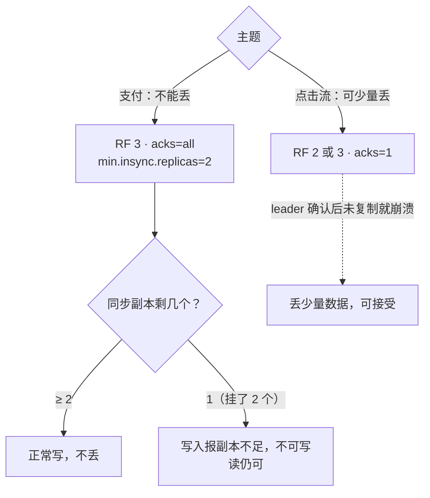

## Q
**Kafka · 支付事件和点击流各用什么持久性配置**｜考点 · 必会

两个主题：支付事件（不能丢）与点击流（偶尔丢几条可以）。选复制因子、`acks`、`min.insync.replicas`。再问：3 个副本里挂了 2 个，支付主题会怎样？

## A
- **支付：** 复制因子 3，`acks=all`，`min.insync.replicas=2`，关闭非干净 leader 选举，生产者开启幂等。写入要至少 2 个同步副本确认才成功，丢一个 broker 不丢数据、不停写。
- **点击流：** 复制因子 2 或 3，`acks=1`，延迟最低，leader 刚确认就崩溃、还没复制，会丢少量数据，可接受。
- **挂了 2 个：** 同步副本只剩 1 个，低于 `min.insync.replicas=2`，生产者写入会报"副本不足"，支付主题不可写；这是用可用性换不丢数据。读取仍可从剩下的副本进行。

- **2026 亮点：** Kafka 4.1 起新集群默认启用 ELR（eligible leader replicas）：ISR 缩到 min.insync.replicas 以下时高水位不再推进，controller 另外记录不在 ISR 里但仍安全的副本，选主顺序是 ISR、ELR、最后已知 leader，所以能减少为恢复可用性而开 unclean 选举、去冒丢数据风险的需要。注意 4.0 里只是预览且默认关闭，启用后集群级 min.insync.replicas 必须存在。
- **面试表述：** 一致性与可用性是配置出来的取舍，按数据价值分主题配置，而不是全局一个值。
