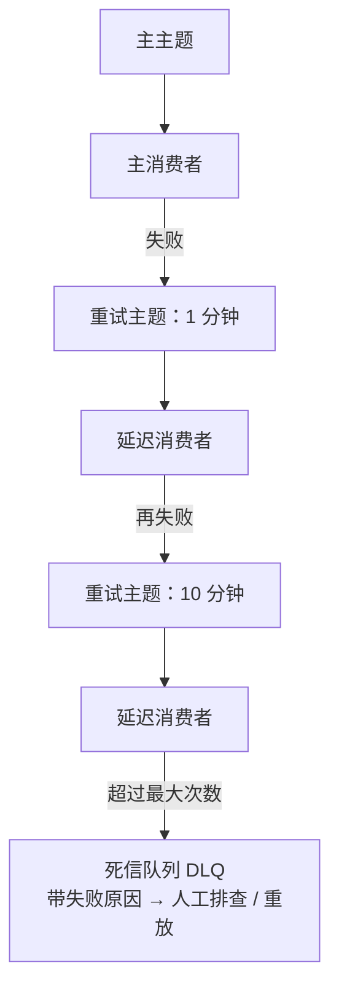

## Q
**Kafka · 为会失败的消息设计重试和死信**｜考点 · 必会

下游服务偶尔不可用，消费者处理消息偶尔失败。设计重试方案，并说明它对顺序的影响，以及什么时候该换 SQS。

## A
- **方案：** 主消费者处理失败就把消息转发到重试主题（可分级，如 1 分钟、10 分钟后重试），由另一个消费者按延迟处理；超过最大次数就进死信队列（DLQ），带上失败原因，供人工排查或修复后重放。
- **对顺序的影响：** 失败消息被挪走后，同键的后续消息会先于它被处理，顺序被打乱；需要严格顺序时，要么原地阻塞重试（同一分区卡住，会拖慢整个分区），要么业务上容忍乱序（如带版本号，旧版本被忽略）。

- **幂等：** 重试意味着可能重复，处理必须幂等。
- **换 SQS：** 如果不需要流的特性（回放、多消费者组），而重试、延迟、死信是核心需求，SQS 内置这些，不必自己实现。爬虫的例子就是这么选的。
- **2026 亮点：** 若用 Share Group，重试次数上限由 broker 管（delivery count），超限消息被归档、不再投递，减少手搭重试主题链的需要；但它不保证跨批次顺序，需要同键有序时仍走上面的方案。
