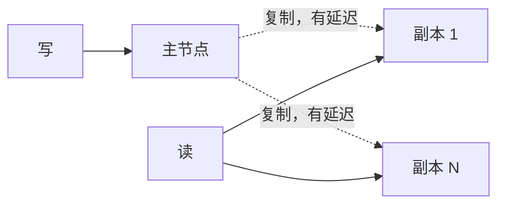

## Q
**PostgreSQL · 用只读副本扩展读，以及复制延迟**｜摘要 · 必会

怎么用副本扩展读取？最大的陷阱是什么？

## A
- **做法：** 写全部发给主节点，读分散到 N 个副本，读吞吐大约放大 N 倍。社交应用读远多于写，所以很有效。
- **陷阱：复制延迟（replication lag）：** 用户刚发了帖子又立刻刷新，如果这次读落到还没追上的副本，就看不到自己刚写的内容，即违反"读自己的写"（read-your-writes）。
- **缓解：** 写后一小段时间内把该用户的读路由回主节点；或者按用户固定副本并让副本追到某个位置再读；对一致性要求高的读直接走主节点。
- **提示：** 副本只扩展读，写吞吐仍受主节点限制。

