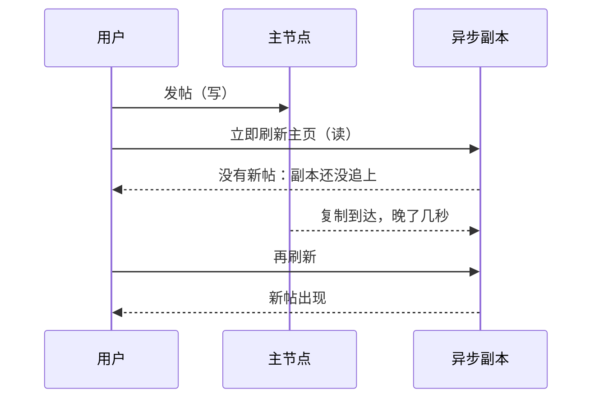

## Q
**PostgreSQL · 发完帖子刷新却看不到**｜考点 · 必会

系统用 1 个主节点加 4 个异步副本，读分散到副本。用户发帖后立即刷新个人主页，经常看不到新帖，几秒后又出现。原因和三种修法？

## A
- **原因：** 复制延迟。写到主节点，刷新的读落到还没追上的副本，违反"读自己的写"。
- **修法一：** 用户写入后的几秒内，该用户的读强制走主节点。
- **修法二：** 记录写入对应的日志位置，只在副本追到这个位置后才让它服务这次读。
- **修法三：** 关键路径（自己的主页）直接读主节点，其他用户的读仍然走副本。
- **不要这样做：** 为这点把所有副本改成同步复制，会拖慢每次写入，而且并不能让落到异步副本的读保证看到新数据。

