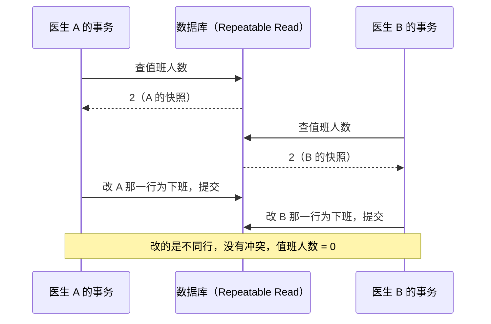

## Q
**PostgreSQL · Repeatable Read 够用吗：写偏斜**｜考点 · 追问

医院规定至少 1 名医生值班。两位医生同时执行：先查值班人数是否大于 1，是就把自己设为下班。在 Repeatable Read 下可能出什么问题？怎样修复？

## A
- **问题（写偏斜，write skew）：** 两人各自在自己的快照里看到有 2 人值班，都通过检查，各改自己的那一行，提交后值班人数是 0。两个事务改的是不同的行，没有行冲突，所以快照隔离发现不了。
- **说明：** PostgreSQL 的 Repeatable Read 防住了幻读，但"序列化异常"仍可能出现。

- **修法一：** 用 SERIALIZABLE，数据库检测到读写依赖形成环就回滚其中一个，应用重试。
- **修法二：** 在检查时对所有值班医生的行加 `FOR UPDATE`，让两个事务互相等待。
- **启示：** 当不变量涉及多行时，单行锁与快照都不够，要把相关的行都锁住或用 SERIALIZABLE。
