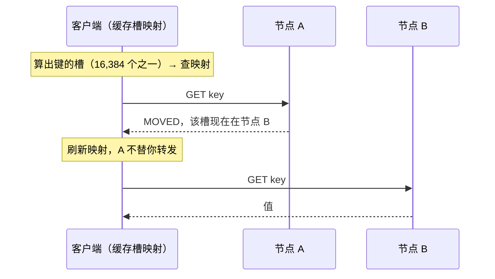

## Q
**Redis · 集群与哈希槽**｜摘要 · 必会

Redis 集群怎么分片？客户端怎么找到数据在哪个节点？两个键怎么放到一起？

## A
- **三种部署：** 单节点、带高可用副本、集群。
- **哈希槽（hash slot）：** 集群里每个键哈希到 16,384 个槽之一，每个槽归一个节点，每个节点持有一部分槽，也就持有一部分键。加节点时，槽（连同其中的键）迁移过去。
- **2026 亮点：** 搬槽已可以原子完成：Valkey 9.0 的原子槽迁移、Redis 8.4 开源版的 `CLUSTER MIGRATION` 把整个槽作为一个单元流式搬过去（大集合按元素流式传输），源节点在交接完成前保留全部数据，不再逐 key `MIGRATE`，也就没有一个槽的 key 分在两个节点、多 key 命令要靠 ASK 重试的中间状态。代价：最后交接时源节点会短暂暂停该槽的写入（有超时上限），大 key 仍要提前治理。
- **客户端缓存槽到节点的映射，** 自己算出键的槽，直接连到对应节点。槽因再均衡或故障转移而移动时，服务器回复 `MOVED`，客户端刷新映射。节点之间用 gossip 协议交换集群状态；问错了节点，它不会替你转发，只告诉你该去哪。

- **集群做得比你想的少：** 没有查询路由器去拆分请求再合并结果。除少数例外，一个命令涉及的数据要都在同一个节点，否则报错，而不是变慢。
- **哈希标签（hash tag）：** 只对键里 `{}` 内的部分算哈希，`{user:123}:posts` 和 `{user:123}:likes` 总在同一个槽，可以放进同一个 `MULTI` 事务。
