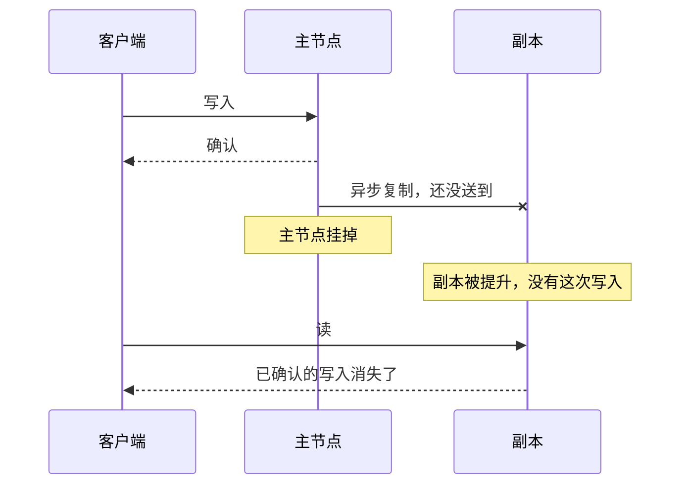

## Q
**Redis · 复制是异步的，意味着什么**｜摘要 · 必会

Redis 的副本有什么用？异步复制带来哪些后果？

## A
- **异步：** 主节点在副本看到写入之前就先确认了。主节点挂掉、副本被提升时，最后一小段已确认的写入可能直接消失。这是 Redis 不适合当系统记录（system of record）的最深层原因，也是分布式锁会失效的根源。

- **读扩展：** 集群模式下，客户端在连接上发 `READONLY` 允许读副本（客户端库一般暴露成配置项）；非集群模式则把读流量直接指向副本。
- **代价：** 副本读比主节点落后一个复制延迟，你接受的是可能读到旧数据。
