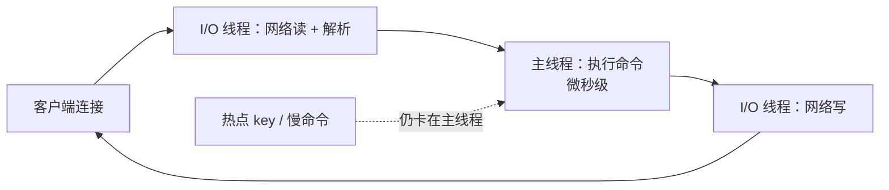

## Q
**Redis · 性能与"N+1 查询"**｜摘要 · 必会

一个 Redis 节点能多快？为什么对关系库是反模式的 N+1，在 Redis 里还能容忍？

## A
- **数量级：** 单节点约每秒 10 万次写入；命令本身在微秒级执行，网络上读延迟在亚毫秒。
- **2026 亮点：** 这个数字是老的单线程口径。Valkey 8 / Redis 8 把网络读写和解析交给 I/O 线程，命令执行仍在主线程，厂商基准里单实例吞吐可翻几倍（Valkey 8 的 SET 达到百万级每秒）；代价是多占 CPU，热点 key 和慢命令仍卡在主线程。

- **后果：** 对 SQL 数据库毁灭性的 N+1（对列表里每个元素各发一次查询），在 Redis 里每条命令只花服务器几微秒，而且可以用流水线（pipeline）或 `MGET` 把一百次往返合成一次。仍然最好避免，但不会毁掉设计。
- **速度来自于全在内存：** 不是所有场景都合适，但很多场景非常合适。
