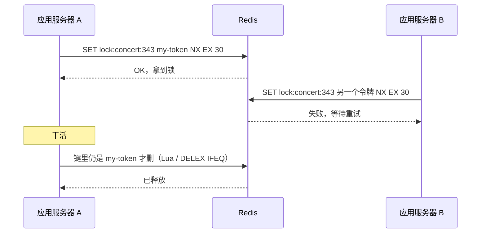

## Q
**Redis · 分布式锁：加锁和解锁的正确写法**｜摘要 · 必会

用 Redis 实现互斥锁，加锁命令是什么？为什么释放时不能直接 `DEL`？

## A
- **为什么 Redis 能当锁：** 它是所有应用服务器都能访问的一台共享服务器，每条命令原子执行；锁就是大家约定的一个键，如 `lock:concert:343`。
- **加锁：** `SET lock:concert:343 my-token NX EX 30`。`NX` 表示键不存在才设置成功，成功就拥有锁，失败就等待重试；`EX 30` 给键设 30 秒过期，持有者崩溃也不会永远占着；`my-token` 是你独有的随机值。
- **释放：** 不能直接 `DEL`——你的锁可能已过期并被别人拿到，盲删会删掉别人的锁。要检查键里仍是你的令牌才删，检查和删除写成一个 Lua 脚本：Redis 把整个脚本当一条命令在单线程上执行，所以是原子的。

- **2026 亮点：** 释放锁不必再写 Lua：Redis 8.4 提供原生的 `DELEX key IFEQ <token>`，Valkey 9.0 提供 `DELIFEQ key <token>`，都是原子的“令牌相同才删”，复杂度 O(1)；老版本仍用 Lua。它只解决误删别人的锁，主从切换丢锁、持有者暂停后锁已过期这两类问题仍要靠围栏令牌。
- **这是悲观锁：** 先拿锁再干活。Redis 也支持乐观并发控制：`WATCH` 一个键，`MULTI/EXEC` 执行事务，被监视的键期间被改过就中止。
