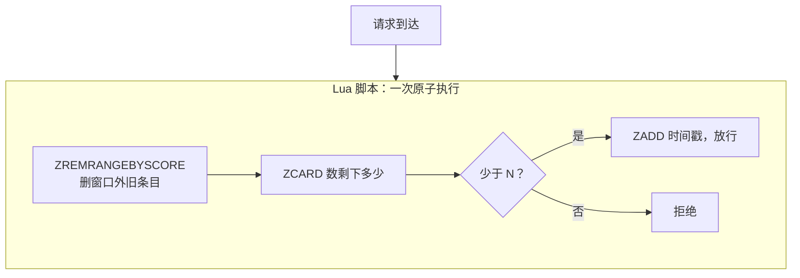

## Q
**Redis · 限流：滑动窗口**｜摘要 · 必会

需要滑动窗口限流时用什么结构？每个请求的步骤是什么？

## A
- **结构：** 每个用户一个有序集合，请求时间戳当分数。
- **每个请求的步骤：** `ZREMRANGEBYSCORE` 删除窗口之外的旧条目 → `ZCARD` 数剩下多少 → 少于 N 就 `ZADD` 加入新请求。
- **原子性：** 整个序列写成 Lua 脚本，一次执行，避免并发请求交错。

