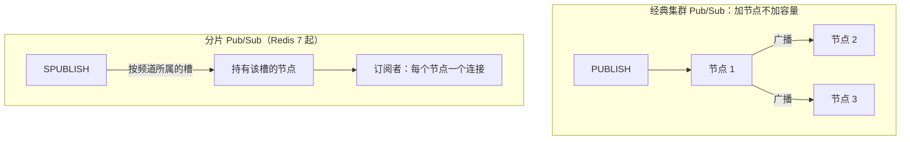

## Q
**Redis · 发布订阅（Pub/Sub）与它的保证**｜摘要 · 必会

Pub/Sub 是什么保证？集群里怎么扩展？连接数是按频道算吗？

## A
- **是什么：** 发布者向频道名发消息，订阅者监听该名字，频道是"有人订阅就存在"，无需创建。`PUBLISH channel message`、`SUBSCRIBE channel`。适合聊天、实时通知这种解耦生产者与消费者的场景。
- **至多一次（at most once）：** 订阅者离线时发布的消息会丢，不持久，不能回放。需要离线送达或持久扇出时，用 Redis 流，或把 Pub/Sub 与队列（SNS→SQS、Kafka）、发件箱模式（先把消息写进数据库）配合，让消费者之后追上。
- **旧说法已过时：** 经典的集群 Pub/Sub 把每条消息广播到每个节点，加节点不加容量。Redis 7 起有分片 Pub/Sub（`SPUBLISH` / `SSUBSCRIBE`），按频道所属的槽路由，容量随集群扩展。集群里应使用这种。
- **连接开销按节点算，不按频道：** 订阅者对一个节点只持有一个连接，在这一个连接上收它订阅的所有频道，所以百万个频道不意味着百万个连接。分片 Pub/Sub 下，订阅者只需连持有相关频道的那些节点。

