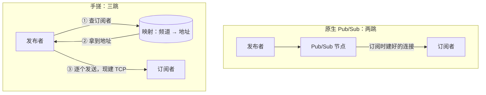

## Q
**Redis · 为什么别自己用键值手搓发布订阅**｜摘要 · 追问

有人提议：每个主题一个键，值是订阅者服务器地址集合，发布时查键再逐一发送。为什么不如原生 Pub/Sub？

## A
- **多一跳：** 原生是两跳（客户端发给 Pub/Sub 节点，节点分发给订阅者）。手搓是三跳（查订阅者、拿到地址、逐个发送）。
- **新建连接最贵：** 最后一跳很可能没有现成的 TCP 连接，要现建；原生 Pub/Sub 在订阅时就建好并保持打开，所以发送快。

- **内存与心跳：** 原生只跟踪有活跃订阅者的频道，最后一个订阅者断开频道就被清掉。手搓的映射里，服务器挂了需要有人清除条目，得加心跳或 TTL，主题多时又增加大量噪音。
- **结论：** 如果场景像 Pub/Sub，就用 Pub/Sub。
