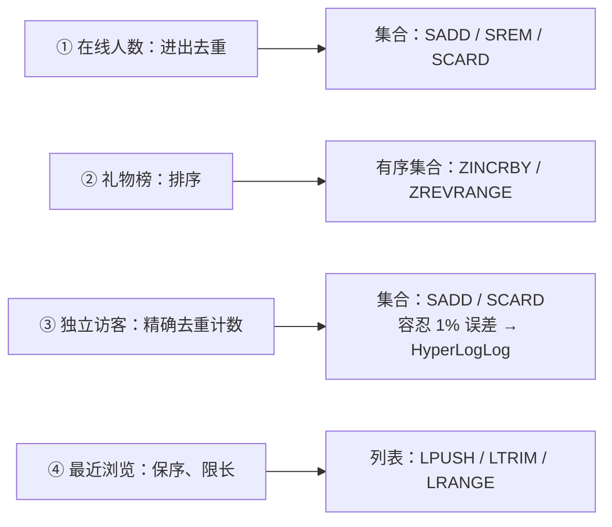

## Q
**Redis · 给需求选数据结构**｜考点 · 必会

为一个直播平台设计下面四个功能，各用 Redis 哪种结构、哪几条命令？①房间实时在线人数（允许进出）②直播间礼物榜前 10 ③今日独立访客的精确集合（约 50 万）④每个用户最近 20 条浏览记录。

## A
- **① 在线人数：** 用集合：进入 `SADD room:1:online user`，离开 `SREM`，人数 `SCARD`；只要计数则用字符串 `INCR / DECR`，但进出重复上报会计错，集合天然去重。
- **② 礼物榜：** 有序集合：`ZINCRBY gifts:room1 金额 用户`，前 10 用 `ZREVRANGE gifts:room1 0 9 WITHSCORES`，全部是对数时间。
- **③ 独立访客：** 集合 `SADD uv:2026-11-03 user`，`SCARD` 得数量。50 万个成员需要几十 MB 内存；如果可接受约 1% 误差，换成 HyperLogLog 只要约 12 KB。
- **④ 最近浏览：** 列表：`LPUSH` 加新的，`LTRIM key 0 19` 保留 20 条，`LRANGE` 读取。
- **思路：** 先问是否需要去重、排序、精确，再选结构；键设计成 `类型:id`，便于以后分片。

