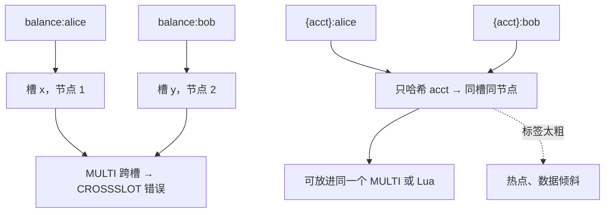

## Q
**Redis · 转账要改两个键，集群里怎么办**｜考点 · 必会

在 Redis 集群里用 `MULTI` 把 `balance:alice` 扣 10、`balance:bob` 加 10。会发生什么？怎么改键名？有什么副作用？

## A
- **会发生什么：** 两个键哈希到不同的槽，可能在不同节点，集群拒绝跨槽的事务，返回 `CROSSSLOT` 错误，而不是慢一点完成。
- **改法：** 用哈希标签让它们同槽，如 `{acct}:alice`、`{acct}:bob`，只对花括号内部分哈希；这样可以放进同一个 `MULTI`，或者一个 Lua 脚本。
- **副作用：** 所有用同一标签的键都落在同一个槽、同一台节点，标签太粗会造成热点和数据倾斜（所有账户都用 `{acct}` 就全压在一个节点上）。标签只应覆盖"必须一起操作的最小集合"。

- **更合理的设计：** 转账本来是需要持久性的账务，Redis 异步复制可能丢确认过的写入，更应放在关系库事务里；这里重点考察你知道槽的限制与代价。
