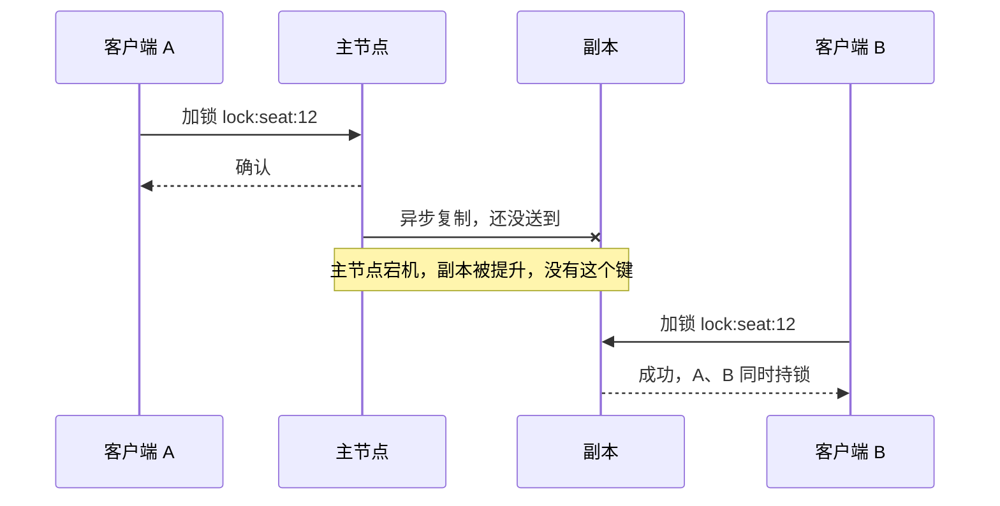

## Q
**Redis · 主节点故障后两个人持有同一把锁**｜考点 · 必会

客户端 A 在主节点上拿到 `lock:seat:12`，主节点随即宕机，副本被提升，客户端 B 也拿到了同一把锁。A、B 都在写座位记录。为什么会这样？写出两种防护，并说明哪种才保证正确性。

## A
- **为什么：** 复制是异步的，主节点在副本看到该锁之前就确认了 A 的加锁；副本被提升后没有这个键，于是 B 加锁成功。
- **防护一，Redlock：** 在多个独立节点的多数上加锁，缩小这类窗口。但暂停或变慢的客户端仍可能在锁过期后继续动作，并不保证正确性。

- **防护二，围栏令牌或条件更新：** 每次授予锁附带递增数字，或给座位行带版本号，写入时 `UPDATE seat SET owner = ? WHERE id = 12 AND version = ?`，旧持有者的写会因版本不匹配而失败。这种在数据所在处的检查才是正确性保证。
- **结论：** Redis 锁是减少重复工作的效率工具；真正不能重复的操作靠数据库约束。
