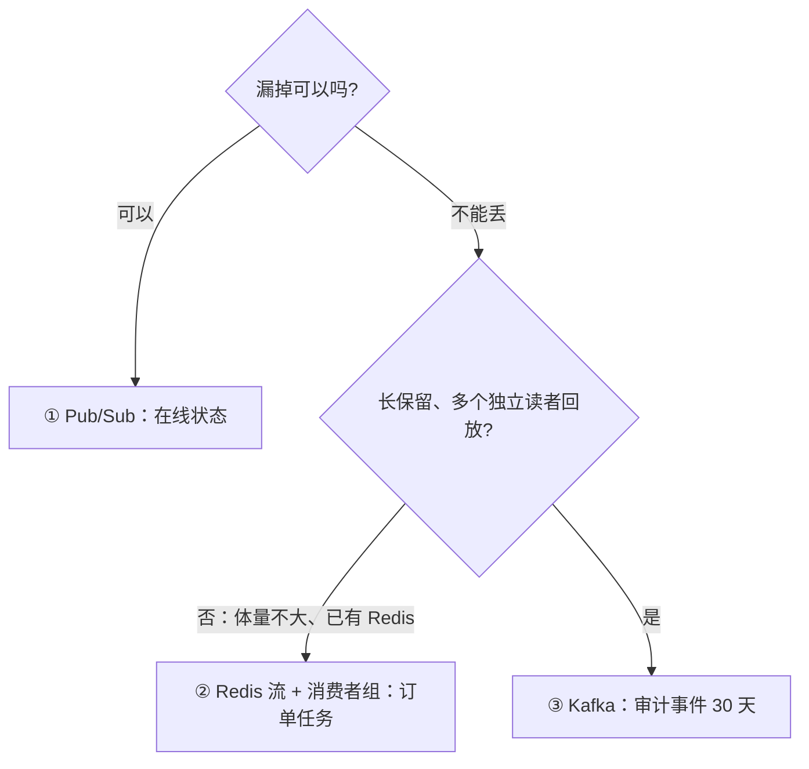

## Q
**Redis · Pub/Sub、流、Kafka 怎么选**｜考点 · 必会

三个需求：①在线状态变化要实时推给当前打开聊天窗口的好友，漏掉也不要紧；②订单创建后要交给后台 worker 处理，不能丢，worker 可能崩溃；③审计事件要保存 30 天，三个团队独立回放分析。各选哪个？

## A
- **① Pub/Sub：** 只给当下在线的订阅者，至多一次；漏掉没关系，简单快速。集群里用分片 Pub/Sub。
- **② Redis 流 + 消费者组：** 持久到持久化设置所允许的程度，worker 崩溃后别的 worker 用 `XAUTOCLAIM` 接手；处理要幂等，因为可能重复。体量不大且已有 Redis 时合适。
- **③ Kafka：** 长保留、多个独立消费者组各自回放；Redis 流受内存限制，也没有同等的日志保留与回放生态。
- **判断依据：** 能不能丢、要不要回放、几个独立读者、规模和保留期。

